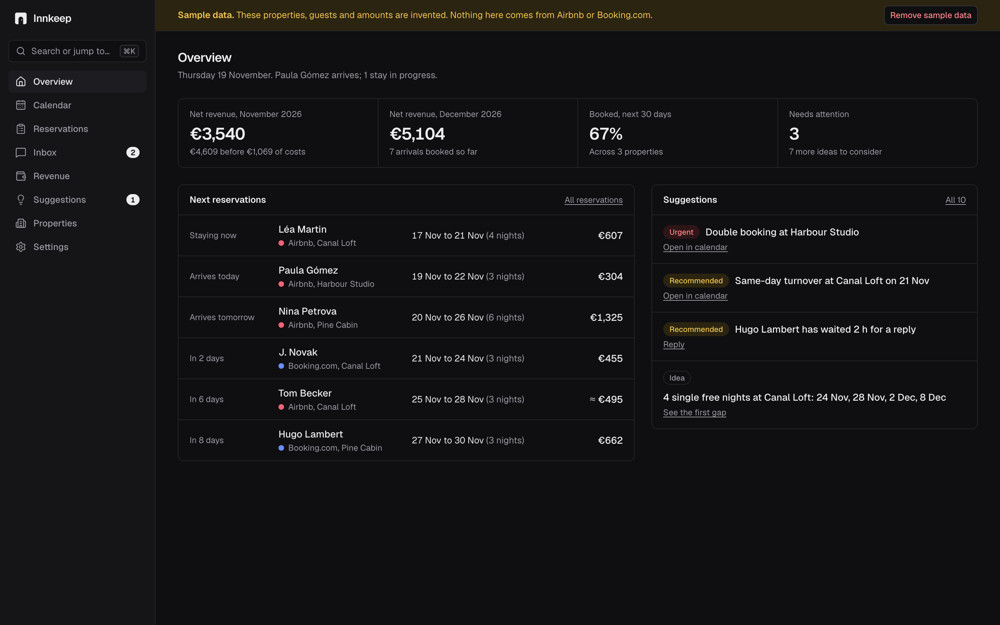
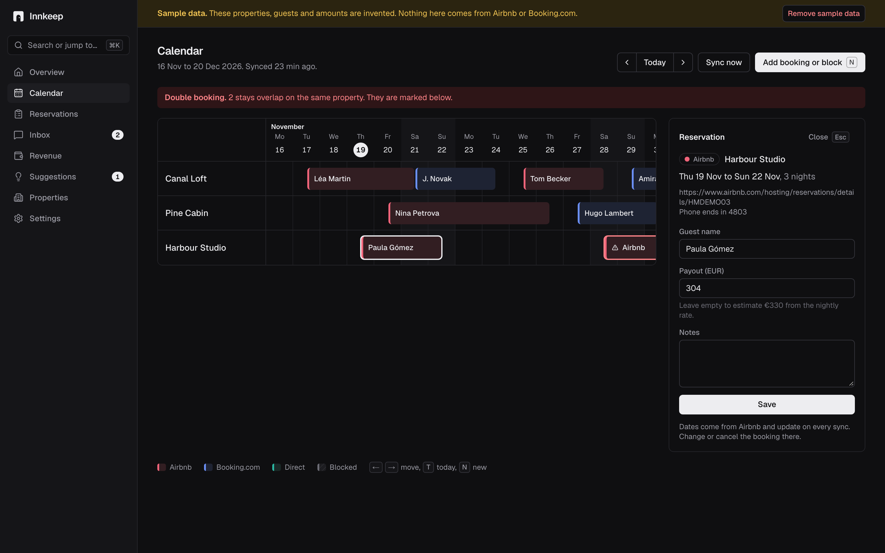
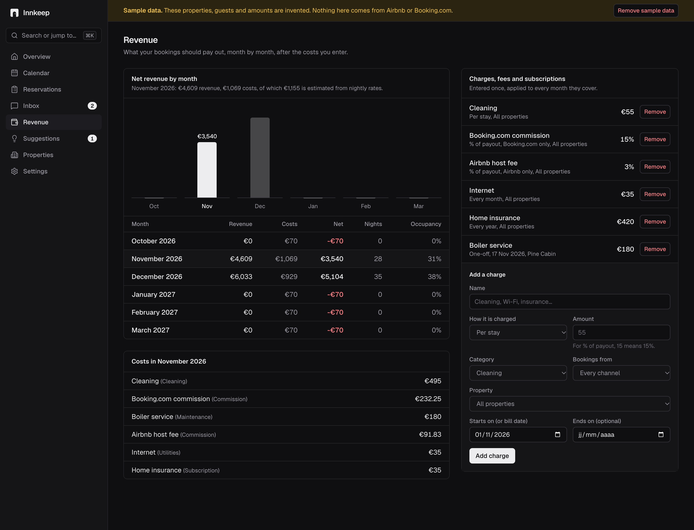

<h1 align="center">Innkeep</h1>

<p align="center">
  The open-source channel manager for hosts with one or two places.<br />
  One calendar for Airbnb and Booking.com, revenue after costs, and suggestions on what to fix.
</p>

<p align="center">
  <strong>Innkeep works with a Chrome extension, included in this repository.</strong><br />
  Calendar links only carry dates. The extension reads the rest (guests, payouts, prices, reviews)<br />
  from your own Airbnb and Booking.com pages. <a href="extension/README.md">How it works and what it reads</a>.
</p>

<p align="center">
  <a href="#quick-start">Quick start</a> ·
  <a href="#features">Features</a> ·
  <a href="#what-it-does-not-do">Limits</a> ·
  <a href="docs/ALTERNATIVES.md">Alternatives</a> ·
  <a href="CONTRIBUTING.md">Contributing</a>
</p>



## Why

Channel managers are built and priced for agencies. If you rent out one or two
places, you mostly need three things: calendars that never disagree, a clear
view of who is coming and what it pays, and a nudge when something needs
attention. Innkeep does those, runs on your own machine, and keeps your data in
a single file you own.

## Quick start

Not technical? Follow the step-by-step guide instead:
[docs/INSTALL.md](docs/INSTALL.md) ([en français](docs/INSTALLATION.fr.md)).
It needs no terminal: you download a folder and double-click a file.

Requires Node.js 22 or 24 (24 is what the hosted version runs).

```bash
git clone https://github.com/jetaix/Innkeep
cd Innkeep
bun install
bun run dev
```

Open http://localhost:3000/overview and click **Load sample data**, or add your
first property. Data lives in `data/innkeep.db` (SQLite); there is nothing else
to set up.

For production: `bun run build && bun run start`, behind HTTPS, on a machine with a
persistent disk.

## Features

- **Calendar.** Every stay across channels on one timeline, with double
  bookings flagged.
- **Two-way sync.** Imports each listing's calendar link every 15 minutes, on
  startup and whenever you open the app after a pause, and
  gives each platform a link that blocks what the other sold.
- **Reservations.** Who is staying, arriving this week and later, with nights
  and expected payout.
- **Cleaning.** A cleaning after every check-out, the time there is to do it,
  who does it, done or skipped, and a schedule to copy or print for your
  cleaner. A Telegram message tells you each time one has to be arranged. The
  idea comes from [RentTools.io](https://github.com/Gribadan/RentTools.io) (MIT).
- **Revenue.** Month-by-month revenue, costs and net. Add cleaning per stay,
  commission as a percentage, monthly or yearly subscriptions and one-off bills.
- **Pricing.** The price of each night on Airbnb and Booking.com side by side,
  what each platform leaves you after its cut, and suggestions to bring them
  in line. Prices are read from your own calendars by the browser extension.
- **Suggestions.** Rules over your own data: double bookings, calendars that
  stopped syncing, guests waiting for a reply, single unsold nights, pricing
  signals. Optionally, advice written by Claude for your listings.
- **Listing details.** One master copy with per-channel overrides, and a flag
  when a platform is out of date.
- **Listing preview.** Each platform's public listing as guests see it, side
  by side: title, photos, rating, description, amenities and the price shown
  for the same stay.
- **Data freshness.** A section of Settings lists everything read from the platforms and
  from Claude, how old it is and the button that refreshes it; the sidebar
  counts what has gone stale.
- **Reviews.** What guests wrote on Airbnb and Booking.com in one list, with
  ratings, your replies, and filters for unanswered and lower-rated ones.
- **Keyboard.** Command menu (`⌘K`), `G` then a letter to jump between pages,
  per-page shortcuts.
- **MCP server.** Lets an AI assistant read your calendar, revenue and
  suggestions, and block dates.
- **Light and dark mode**: follow your system or pick one.
- **English and French**, switchable from the sidebar or Settings.




## Connecting a listing

On a property page, for each channel:

1. **Import.** Copy the calendar export link from the channel and paste it in
   Innkeep.
   - Airbnb: Calendar → Availability → Connect calendars → _Export calendar_
   - Booking.com: Extranet → Rates & Availability → Sync calendars → _Export_
2. **Export.** Copy the Innkeep link shown on the same card and add it in that
   screen as an imported calendar.

The export link for Airbnb contains everything _except_ Airbnb's own bookings
(and likewise for Booking.com), so a channel never sees its own reservations
echoed back.

## What it does not do

Airbnb and Booking.com give every host calendar links. Everything else
(reservation details, listing content, messaging, rates) is reserved for
approved software partners, and Innkeep is not one.

| Capability                     | Status       | How                                                              |
| ------------------------------ | ------------ | ---------------------------------------------------------------- |
| Calendar sync, both directions | Works        | iCal import and export                                           |
| Double-booking detection       | Works        | Overlap check across channels                                    |
| Guest names, payouts, history  | Extension    | The browser extension reads them from your reservations pages    |
| Listing details on platforms   | Semi-manual  | Edit once, copy into each platform, mark as published            |
| Guest messages                 | No           | Read and answered on each platform; Innkeep does not handle them |
| Changing prices on platforms   | No           | Suggestions tell you what to change; you change it there         |
| Login and multiple users       | One password | `APP_PASSWORD` protects every page; no separate accounts yet     |

iCal is not instant: platforms re-read links on their own schedule, so a
double booking is still possible in the gap. Innkeep flags it; it cannot
prevent it. If you need instant sync and in-app messaging, a partner-API
product is the right tool; the site's **/alternatives** pages compare them
([how to find and edit them](docs/ALTERNATIVES.md)), including the ones with
free tiers.

## Configuration

Every setting is optional. Copy [.env.example](.env.example) to `.env.local`.
To run Innkeep online for you and your partner, with a password and Telegram
notifications, see [docs/DEPLOY.md](docs/DEPLOY.md).
The Settings page shows what is switched on.

| Variable                | Default             | Purpose                                                 |
| ----------------------- | ------------------- | ------------------------------------------------------- |
| `DATABASE_PATH`         | `./data/innkeep.db` | SQLite file location                                    |
| `TURSO_DATABASE_URL`    | unset               | A hosted Turso database instead of the file             |
| `TURSO_AUTH_TOKEN`      | unset               | The token of that database                              |
| `CRON_SECRET`           | unset               | Turns on `/api/cron` for a scheduler (serverless hosts) |
| `APP_URL`               | from the request    | Public URL used in export links                         |
| `SYNC_INTERVAL_MINUTES` | `15`                | Background sync period, `0` to disable                  |
| `ANTHROPIC_API_KEY`     | unset               | Claude's key; or paste it on the Suggestions page       |
| `AI_MODEL`              | `claude-opus-5-5`   | Model used for AI advice                                |
| `MCP_TOKEN`             | unset               | Turns on the MCP server at `/api/mcp`                   |
| `EXTENSION_TOKEN`       | unset               | Lets the browser extension send details                 |
| `APP_PASSWORD`          | unset               | Asks for this password before any page opens            |
| `TELEGRAM_BOT_TOKEN`    | unset               | With the chat below, turns on Telegram notifications    |
| `TELEGRAM_CHAT_ID`      | unset               | The person or group the notifications go to             |
| `TELEGRAM_LANGUAGE`     | `en`                | Language of the notifications: `en` or `fr`             |
| `LANDING_ONLY`          | unset               | `1` publishes only the landing and Alternatives pages   |

### Browser extension

Calendar links carry dates only. The **Innkeep Companion** extension in
[`extension/`](extension/) reads the rest from your own Airbnb and Booking.com
pages: reservations with guest names and payouts, past and cancelled stays,
nightly prices, your listing's details and photos, the public listing as
guests see it, and reviews. Its toolbar button offers **Update reservations**
(quick) and **Read everything** (a guided run through your pages in one tab).
See [extension/README.md](extension/README.md) for setup and for the risk you
take by using it: the platforms' terms restrict automated data collection.

### Claude (AI advice)

Open **Suggestions** in the sidebar and go to its Claude section, create an API key in the Anthropic Console,
paste it and press **Test and connect**. Innkeep checks the key before keeping
it in your local database; setting `ANTHROPIC_API_KEY` on the server works too
and takes precedence.

**Get advice** then sends one summary of your account to Anthropic: listing
text, stay dates and payouts, nightly prices by month, revenue and costs.
Guest names, messages, phone numbers and confirmation codes are never sent.
Claude has no data on other listings or your local market, so its pricing
advice comes from your own history and the prices your platforms show. Each
request is billed to your key; nothing runs in the background.

### MCP server

Set `MCP_TOKEN`, then add Innkeep to your assistant (Settings shows the exact
snippet for your address):

```json
{
  "mcpServers": {
    "innkeep": {
      "type": "http",
      "url": "https://your-innkeep/api/mcp",
      "headers": { "Authorization": "Bearer YOUR_MCP_TOKEN" }
    }
  }
}
```

Tools: `list_properties`, `list_reservations`, `get_revenue`,
`list_suggestions`, `block_dates`.

## Security

There is no login yet. Run Innkeep on a private network or behind a reverse
proxy that authenticates. See [SECURITY.md](SECURITY.md) for the routes that
are safe to expose and how to report a vulnerability.

## Stack

Next.js 16 (App Router, server components and actions), TypeScript, SQLite
(libSQL: a local file, or Turso when hosted) with Drizzle, Tailwind CSS 4, zod, cmdk, Vitest.
[docs/TECH-BENCHMARK.md](docs/TECH-BENCHMARK.md) explains each choice and what
was considered instead. [CONTRIBUTING.md](CONTRIBUTING.md) describes how the
code is organised.

```bash
bun run check   # format, lint, types, tests, build
```

## Roadmap

- Separate accounts for each person
- Per-night pricing and minimum stays
- Partner-API adapters for hosts who have credentials

## License

[MIT](LICENSE). Innkeep is not affiliated with Airbnb, Booking.com or
Hospitable.
